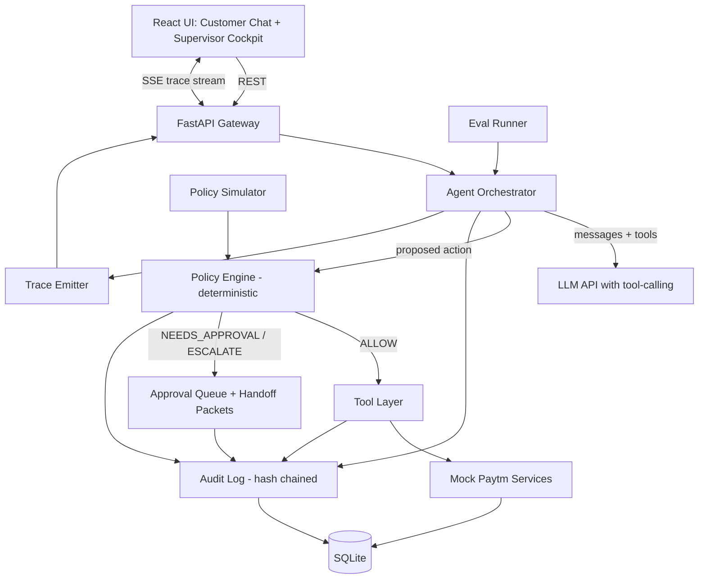
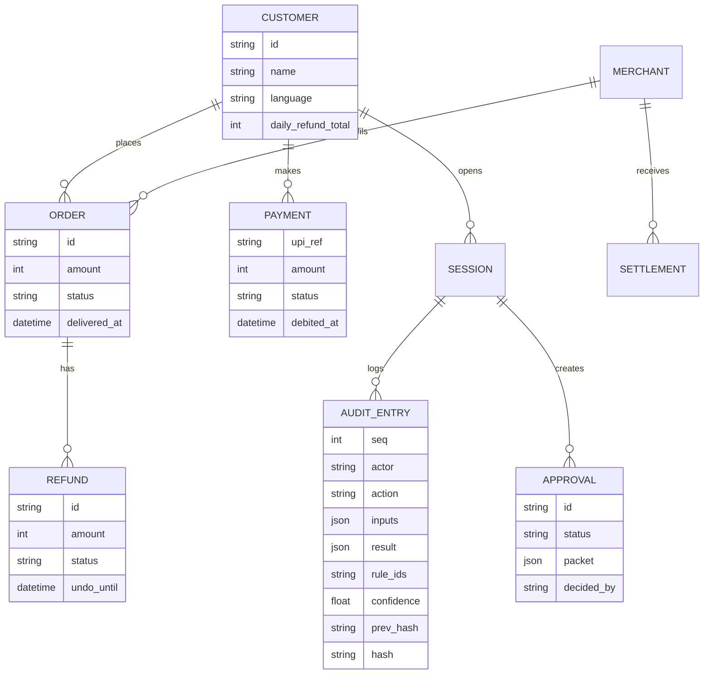

# Sakshi — Architecture

> **Status:** Draft | **Last updated:** 2026-10-22

## 1. System Overview
Sakshi is a web app with a Python backend that runs an LLM-driven agent loop and a React frontend that shows a customer chat and a supervisor cockpit side by side. The central design rule is **propose, verify, execute**: the LLM only *proposes* tool calls; a deterministic policy engine decides whether each runs; only then does a mock backend change state. Every step is written to a hash-chained audit log and streamed to the UI as trace events.

The backend systems (orders, UPI, CRM, notifications, settlements) are mocks backed by SQLite, shaped like real payment APIs so the agent code would not change when pointed at real services.

## 2. Architecture Diagram

## 3. Tech Stack
| Layer | Technology | Rationale |
|---|---|---|
| Frontend | React + Vite + TypeScript | Fast to build; SSE and state handling are straightforward |
| UI library | Tailwind CSS with custom neobrutalist tokens; Radix primitives for accessible dialogs, tabs, tooltips | Full control over thick borders and hard shadows; accessibility handled by Radix |
| Icons | Lucide | Consistent stroke icons that fit chunky borders |
| Backend | Python 3.11 + FastAPI | Async, SSE support, quick to write |
| Agent | LLM API with native tool-calling (recommendation: Claude API, model chosen by team) | Reliable structured tool use; provider is swappable behind an adapter |
| Policy engine | Plain Python with a YAML policy file | Deterministic, testable, readable by non-engineers |
| Database | SQLite (SQLAlchemy) | Zero setup; enough for demo scale |
| Streaming | Server-Sent Events | Simpler than WebSockets for one-way trace events |
| Evals | pytest plus a YAML case file | Reuses test tooling; runnable from CLI and UI |
| Infra/Hosting | Local plus a single cloud VM or free-tier host with HTTPS; Docker Compose | Reproducible demo; fallback to localhost |
| Auth | Role switch (customer / supervisor) via a signed demo token | Real auth is out of scope; roles still enforced server-side |

## 4. Component Breakdown
### 4.1 Agent Orchestrator
- **Responsibility:** Runs the loop (intent, propose tool calls, observe, continue or stop), assembles prompts, handles language and tone, computes confidence inputs.
- **Interfaces:** `POST /api/chat`; internal `propose()` returning tool calls; emits trace events.
- **Depends on:** LLM adapter, Policy Engine, Tool Layer, Audit Log.

### 4.2 Policy Engine
- **Responsibility:** Evaluates each proposed action against versioned rules; returns ALLOW / NEEDS_APPROVAL / DENY / ESCALATE with rule IDs.
- **Interfaces:** `evaluate(action, context) -> Verdict`; `load_policy(version)`.
- **Depends on:** Policy YAML, customer and order facts from the Tool Layer (read-only tools).

### 4.3 Tool Layer
- **Responsibility:** Typed functions the agent can call: `get_order`, `get_payment`, `get_customer_history`, `check_refund_policy`, `issue_refund`, `undo_refund`, `request_upi_reversal`, `update_crm`, `notify_customer`, `get_settlement`, `escalate`. Read tools bypass approval; write tools only run after ALLOW.
- **Interfaces:** JSON-schema tool definitions exposed to the LLM; HTTP calls to Mock Services.
- **Depends on:** Mock Services.

### 4.4 Mock Services
- **Responsibility:** Realistic order, payment, CRM, notification, merchant and settlement behavior with latency and injectable failures.
- **Interfaces:** Internal HTTP/function API; `/api/admin/failures` for toggles.
- **Depends on:** SQLite.

### 4.5 Audit Log
- **Responsibility:** Append-only, hash-chained entries; chain verification.
- **Interfaces:** `append(entry)`, `verify()`, `get_for_action(id)`.
- **Depends on:** SQLite; single-writer lock.

### 4.6 Trace Emitter
- **Responsibility:** Converts internal events to typed trace events with sequence numbers; supports replay on reconnect.
- **Interfaces:** `GET /api/trace/stream?session=` (SSE).
- **Depends on:** Orchestrator, Policy Engine, Audit Log.

### 4.7 Approval Queue & Handoff
- **Responsibility:** Stores pending approvals and handoff packets; applies human decisions and "take over" sessions.
- **Interfaces:** `/api/queue`, `/api/queue/{id}/approve|reject|takeover`.
- **Depends on:** Audit Log, Tool Layer.

### 4.8 Eval Runner & Policy Simulator
- **Responsibility:** Executes case suites; replays recorded proposals under alternate policies.
- **Interfaces:** `POST /api/evals/run`, `POST /api/policy/simulate`.
- **Depends on:** Orchestrator, Policy Engine.

### 4.9 Frontend
- **Responsibility:** Split Stage layout (chat left, cockpit right), approval queue, policy panel, eval scoreboard, demo switcher.
- **Interfaces:** REST + SSE.
- **Depends on:** Backend API.

## 5. Data Model

## 6. API Design
| Method | Endpoint | Purpose | Auth required |
|---|---|---|---|
| POST | /api/chat | Send a user message; returns session and message IDs | Yes (customer/merchant) |
| GET | /api/trace/stream | SSE stream of trace events for a session | Yes |
| GET | /api/actions/{id}/explain | Explanation built from audit entries | Yes |
| GET | /api/audit | List audit entries; `?verify=true` checks the chain | Supervisor |
| GET | /api/queue | Pending approvals and handoffs | Supervisor |
| POST | /api/queue/{id}/approve | Approve an action | Supervisor |
| POST | /api/queue/{id}/reject | Reject with reason | Supervisor |
| POST | /api/queue/{id}/takeover | Supervisor takes over chat | Supervisor |
| POST | /api/refunds/{id}/undo | Undo within window | Supervisor |
| GET/PUT | /api/policy | Read or update policy (versioned) | Supervisor |
| POST | /api/policy/simulate | Replay cases under proposed policy | Supervisor |
| POST | /api/evals/run | Run eval suite | Supervisor |
| POST | /api/admin/failures | Toggle failure injection | Supervisor |
| POST | /api/demo/scenario | Load a seeded scenario | Supervisor |

## 7. Infrastructure & Deployment
- Docker Compose: `api` (FastAPI) and `web` (static build served by a small server or the API).
- Environments: `local` (default) and `demo` (hosted VM with HTTPS). No staging for a hackathon.
- Config via environment variables (LLM key, model name, DB path).
- A recorded backup video and Replay mode (feature 19) protect against network or API failure.

## 8. Security Considerations
- **LLM is untrusted for authority:** it can only propose; policy decisions, amount limits, ownership checks, and approvals are enforced server-side in code.
- **Prompt injection:** user text and tool results are treated as data; tool arguments are schema-validated; the policy engine ignores any "authority" claims in text.
- **Fail closed:** invalid policy, missing facts, or engine errors result in DENY or ESCALATE.
- **Role enforcement:** supervisor endpoints verify the role on the server.
- **Secrets:** API keys in env vars only; never sent to the frontend.
- **Data:** all data is synthetic; no real PII or payment credentials.
- **Audit integrity:** hash chain with verification; no update or delete path in code.

## 9. Scalability & Performance
- Expected load: single-digit concurrent sessions in demo; the design (stateless API, SQLite) is not meant for production scale.
- Latency levers: stream trace events immediately; run independent read tools in parallel (customer history, order lookup, policy facts).
- Production path (for the pitch, not the build): Postgres, a queue for tool execution, per-tenant policy stores, and an append-only ledger service.

## 10. Key Technical Decisions & Tradeoffs
| Decision | Alternatives considered | Why this choice |
|---|---|---|
| Propose, verify, execute with a deterministic policy engine | Let the LLM decide limits via prompt | Prompts can be talked around; code cannot. It is also the product's differentiator |
| Hash-chained audit log in SQLite | Plain table; external ledger | Gives tamper evidence cheaply and is demoable |
| SSE for trace | WebSockets | One-way stream, simpler reconnection |
| Explanation templated from audit data | LLM freeform explanation | Prevents invented reasons; keeps "why" faithful to what happened |
| SQLite and mocks | Real sandbox APIs | Reliability in demo; no external dependencies |
| Tailwind with custom tokens | Pre-made neobrutalist component kit | Smaller surface, consistent tokens, fewer surprises |
| Replay mode for demo | Live only | Protects against API latency; clearly labeled to stay honest |

## 11. Open Technical Questions
- [ ] Which LLM provider and model, and what is the rate limit and latency?
- [ ] Is the demo hosted or run locally on the presenter's laptop?
- [ ] How will 3x repeated eval runs fit within API quota?
- [ ] Should confidence combine heuristics only, or also ask the LLM for a self-rating?
