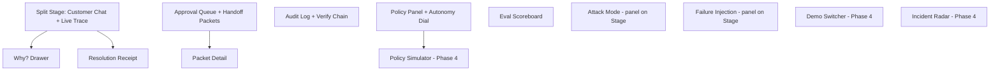
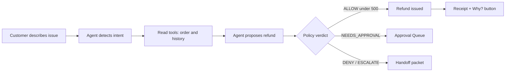
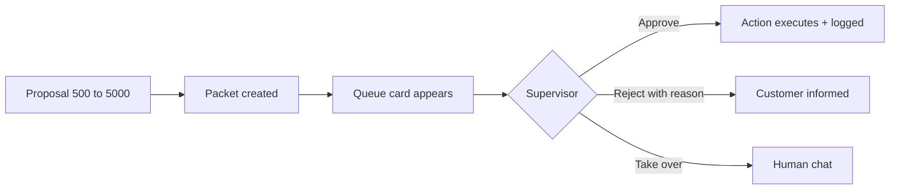
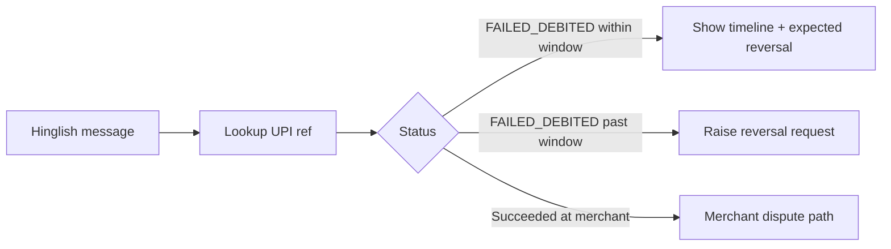
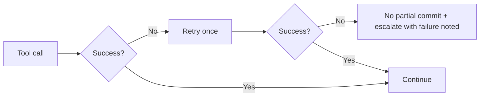

# Sakshi — Design Document

> **Status:** Draft | **Last updated:** 2026-10-22 | **Design direction:** Neo-Brutalism + "Blue Ledger" (blue and mint on cream, ink black)

## 0. Design at a Glance
| | |
|---|---|
| **Concept** | Neo-Brutalism: thick ink borders, hard offset shadows, flat saturated fills. For Sakshi it means every agent step, approval, and decision is a visible, physical block. Nothing is hidden or blurred, which matches the "audited, not just smart" thesis. |
| **Color theme** | Blue Ledger: agent blue and success mint on a warm cream canvas with near-black ink. It feels bold and honest, with fintech-friendly blue as the lead. |
| **Mood keywords** | Bold, transparent, tactile, accountable, confident |
| **Primary typeface** | Space Grotesk (headings) + DM Sans (body) + JetBrains Mono (trace and data) |
| **Signature detail** | The **Trace Slam**: each reasoning step lands as a chunky card with a hard shadow that settles in 140ms, and every action chip has a "Why?" button that presses into its shadow when clicked. |
| **Platforms** | Web (desktop-first for demo on a projector; chat view responsive to mobile) |

*Design choice honored from the brief:* concept and palette direction were set by you (neobrutalism, blue and green accent). Two additions are mine and flagged: a **yellow** and a **red** semantic color so tiered autonomy (approve, escalate, block) can be expressed, and a **navy** reserved for human/supervisor actions.

## 1. Design Direction
### 1.1 Concept & Rationale
Sakshi's pitch is that an AI agent can be trusted because you can see it, bound it, and audit it. Neo-brutalism externalizes structure: borders and shadows make each component an obviously separate, inspectable object, so "reasoning step" and "policy verdict" read as things, not vibes. It also gives the project an identity that stands apart from the glossy gradient dashboards judges will have seen.

The known risk, stated honestly: neobrutalism can feel playful where fintech users expect institutional calm. We manage that by keeping the **customer chat quiet** (readable body text, generous spacing, one border weight) and letting the loud style live on the **chrome and the supervisor trace**, where "transparent and mechanical" is the point. Blue anchors trust; mint marks safe outcomes.

### 1.2 Mood & Personality
| We are... | ...but not |
|---|---|
| Bold | Aggressive |
| Playful in form | Flippant about money |
| Transparent | Cluttered |
| Confident | Boastful |
| Mechanical and honest | Cold |

### 1.3 Design Principles
1. **Show the work.** Every decision has a visible card. *In practice:* a refund appears in the trace as TOOL_CALL, POLICY, CONFIDENCE, DECISION cards before the customer sees "Refund issued".
2. **Color means authority, not decoration.** Blue is the agent, mint is safe and done, yellow is needs-a-human-yes, red is blocked, navy is a human acting. *In practice:* the tier badge is mint under ₹500, yellow up to ₹5,000, red-bordered above.
3. **Calm where the customer is, loud where the supervisor is.** *In practice:* chat bubbles use 1 border weight and no rotation; the trace panel uses terminal ink with colored status chips.
4. **Physical feedback, not animation for show.** Buttons press into their shadows; nothing floats or fades. *In practice:* the Approve button collapses its 4px shadow on click, then the queue card slams to "Approved".
5. **Honest states.** Replay mode, blocked actions, and failures are labeled plainly. *In practice:* a yellow "REPLAY MODE" banner when scenarios aren't live.

### 1.4 Inspiration & References
- **Gumroad and Figma's early brand marketing:** thick borders and hard shadows on friendly fills.
- **Linear-style activity feeds:** the stacked, timestamped event rhythm for the trace (rendered in neobrutalist form).
- **Terminal UIs (htop, k9s):** monospace trace density and status chips for the supervisor panel.

## 2. Voice, Tone & Content Style
- **Voice:** direct, warm, specific about money and status. Short sentences. Matches the user's language (English or Hinglish).
- **Tone shifts:** neutral-friendly in normal chat; calm and extra clear for money problems; plain and non-accusatory when verification is needed; supervisor surfaces are terse and technical.
- **Microcopy examples:**
| Moment | Do | Don't |
|---|---|---|
| Working | "Checking 3 things. About 10 seconds." | Spinner only |
| Refund done | "Done. ₹499 is on its way back to your account. Want to see why I did this?" | "Your request has been processed." |
| Needs approval | "This one needs a teammate's okay. I've sent them everything, so you won't repeat yourself." | "Escalating to higher authority." |
| Verification | "Our records and your description differ slightly. I'm checking one more thing." | "We think you may be lying." |
| Blocked attack | "I can't change refund limits. I can still help with your order." | "Nice try." |
| Hinglish refund | "Aapka ₹499 ka refund ho gaya hai." | Mixed formal Hindi that sounds robotic |
| Empty queue | "Nothing waiting. The agent is handling everything within limits." | "No data." |
- **Capitalization & punctuation:** sentence case for buttons and labels; ALL CAPS only for status chips (RUNNING, PASSED, BLOCKED); no exclamation marks in errors; amounts always with ₹ and thousands separators (₹5,000).

## 3. Color System
### 3.1 Palette & Impression
Blue Ledger pairs a confident mid-blue (the agent) with fresh mint (safe, done) on a warm cream canvas, all outlined in near-black ink. The cream keeps the loud borders from feeling harsh, the blue signals financial competence, and the mint gives immediate positive feedback. Yellow and red appear only when human attention or a block is needed, so they carry meaning. Navy marks human actions.

### 3.2 Core Palette
Light mode only. Neobrutalism depends on black ink over a light canvas, and demos are shown on projectors. A dark mode is in the backlog. The one dark surface is the intentional **Trace panel** (terminal ink).

| Role | Token | Value | Usage |
|---|---|---|---|
| Background | `--color-bg` | #FBF7EC | App canvas (cream) |
| Surface | `--color-surface` | #FFFFFF | Cards, panels, chat bubbles |
| Surface raised | `--color-surface-raised` | #FFFFFF | Modals and drawers (larger shadow distinguishes them) |
| Ink / Text | `--color-ink` | #0D0D0D | Text, borders, shadows |
| Text muted | `--color-text-muted` | #4A4A4A | Captions, timestamps, helper text |
| Primary (agent blue) | `--color-primary` | #4C8DFF | Agent messages, primary actions, tool-call chips |
| Primary hover | `--color-primary-hover` | #6FA3FF | Hover fill |
| Primary pressed | `--color-primary-pressed` | #4C8DFF | Same fill; the motion (shadow collapse) shows the press |
| Accent (mint) | `--color-accent` | #3DDC97 | Success, completed actions, safe tier |
| Accent hover | `--color-accent-hover` | #6BE8B1 | Hover fill |
| Human (navy) | `--color-human` | #002E6E | Supervisor actions, human-handled markers |
| Border | `--color-border` | #0D0D0D | All outlines |

**Trace panel (terminal) tokens**
| Role | Token | Value |
|---|---|---|
| Trace background | `--trace-bg` | #0D0D0D |
| Trace text | `--trace-text` | #E8F5E9 |
| Trace muted | `--trace-muted` | #9AA39E |
| Trace blue (tool calls) | `--trace-blue` | #7FB0FF |
| Trace green (passed) | `--trace-green` | #5CF0A8 |
| Trace yellow (approval) | `--trace-yellow` | #FFD56B |
| Trace red (blocked) | `--trace-red` | #FF8A8D |

### 3.3 Semantic Colors
| Meaning | Token | Value | Usage |
|---|---|---|---|
| Success / auto-resolved | `--color-success` | #3DDC97 | Passed checks, completed actions, tier 1 badge |
| Warning / needs approval | `--color-warning` | #FFC233 | Pending approval, tier 2 badge, replay banner |
| Error / blocked | `--color-error` | #FF5A5F | Blocked actions, failed tools, tier 3 badge, tamper detected |
| Info / agent | `--color-info` | #4C8DFF | Neutral notices, agent activity |
| Human | `--color-human` | #002E6E | Human decisions and takeovers |

**Autonomy tier mapping:** under ₹500 mint "AUTO", ₹500 to ₹5,000 yellow "APPROVAL", above ₹5,000 red "HUMAN ONLY". Thresholds shown always come from the live policy, not hardcoded.

### 3.4 Usage Ratio & Rules
- **60/30/10:** 60% cream and white surfaces, 30% ink (text, borders, shadows), 10% blue, mint, and signals combined.
- Blue fills: agent messages, primary buttons, tool-call chips. Not for body text.
- Mint fills: completion and safe states only. Never for decoration.
- Yellow and red appear only for approvals and blocks, so their presence means "pay attention".
- No gradients, no opacity tricks, no blur. Flat fills only.
- Never use blue, mint, yellow, or red as **text color** on cream or white; use ink. Colored text appears only on the dark trace panel.

### 3.5 Contrast Verification (WCAG 2.1 AA)
Calculated with the WCAG relative luminance formula.
| Pairing | Ratio | Pass |
|---|---|---|
| Ink on Background (#0D0D0D on #FBF7EC) | 18.16:1 | AAA |
| Ink on Surface (#0D0D0D on #FFFFFF) | 19.44:1 | AAA |
| Muted text on Background (#4A4A4A on #FBF7EC) | 8.28:1 | AAA |
| Muted text on Surface | 8.86:1 | AAA |
| Ink label on Primary (#0D0D0D on #4C8DFF) | 6.07:1 | AA |
| Ink label on Primary hover (#6FA3FF) | 7.74:1 | AAA |
| Ink on Accent (#3DDC97) | 11.00:1 | AAA |
| Ink on Warning (#FFC233) | 12.05:1 | AAA |
| Ink on Error (#FF5A5F) | 6.37:1 | AA |
| Navy text on Background (#002E6E on #FBF7EC) | 12.14:1 | AAA |
| White on Navy (human buttons) | 13.00:1 | AAA |
| Trace text on trace bg (#E8F5E9 on #0D0D0D) | 17.28:1 | AAA |
| Trace blue / green / yellow / red on trace bg | 8.84 / 13.41 / 13.87 / 8.58:1 | AAA |
| Trace muted on trace bg | 7.50:1 | AAA |

**Non-text contrast note:** the bright fills alone do not reach 3:1 against the cream background (Primary 2.99, Error 2.85, Accent 1.65, Warning 1.51). They are **never the only boundary**: each is outlined by a 3px ink border (18.16:1 against the background), which satisfies component-boundary contrast. State is also never conveyed by color alone (chips carry text labels and icons).

## 4. Typography
### 4.1 Typefaces
| Role | Font | Weights | Source / Fallback stack | Why |
|---|---|---|---|---|
| Display / Headings | Space Grotesk | 600, 700 | Google Fonts; `'Space Grotesk', 'Archivo', system-ui, sans-serif` | Chunky, geometric, fits neobrutalism and reads well at projector distance |
| Body / UI | DM Sans | 400, 500, 700 | Google Fonts; `'DM Sans', system-ui, sans-serif` | Friendly and readable for chat text, handles Latin well |
| Mono / Trace & data | JetBrains Mono | 400, 600 | Google Fonts; `'JetBrains Mono', ui-monospace, monospace` | Tabular numerals and clear glyphs for rupee amounts, hashes, rule IDs |

**Hinglish note:** Hinglish is written in Latin script, which these fonts render fully. If Devanagari input is supported, add `'Noto Sans Devanagari'` to the body fallback stack.

### 4.2 Type Scale
| Style | Size / Line height | Weight | Letter-spacing | Usage |
|---|---|---|---|---|
| Display | 48 / 52 | 700 | -0.02em | Pitch and scoreboard hero numbers |
| H1 | 32 / 38 | 700 | -0.01em | Page titles (Policy, Evals) |
| H2 | 24 / 30 | 700 | 0 | Panel titles ("Live trace", "Approvals") |
| H3 | 18 / 24 | 600 | 0 | Card titles |
| Body | 16 / 24 | 400 | 0 | Chat messages, descriptions |
| Small / Caption | 13 / 18 | 500 | 0.01em | Timestamps, helper text |
| Button / UI | 15 / 20 | 700 | 0.01em | Buttons, tabs |
| Chip / Status | 12 / 16 | 700 | 0.06em (caps) | Status chips |
| Trace | 13 / 20 | 400 (600 for keys) | 0 | Trace card content (mono) |

### 4.3 Typographic Rules
- Chat line length max 70 characters (about 560px).
- Numerals in mono and `font-variant-numeric: tabular-nums` for all amounts, hashes, and scores.
- Rupee amounts always in bold with the ₹ symbol, never abbreviated in action chips.
- Truncate long IDs in the middle (`UPI-83…F21`) with full value on hover/focus.
- Headings scale down one step below 640px.

## 5. Layout, Spacing & Shape
### 5.1 Grid & Breakpoints
| Breakpoint | Width | Columns | Gutter | Margin |
|---|---|---|---|---|
| Mobile | < 640px | 4 | 16px | 16px |
| Tablet | 640-1024px | 8 | 20px | 24px |
| Desktop | > 1024px | 12 | 24px | 32px (max width 1440px for projector demos) |

### 5.2 Spacing Scale
4px base: 4, 8, 12, 16, 24, 32, 48, 64. Card padding 16 to 24; gaps between trace cards 12; panel gutters 24.

### 5.3 Shape, Borders & Radius
One border weight for containers and one for inner elements, and two radii only.
| Element | Radius | Border | Notes |
|---|---|---|---|
| Buttons | 8px | 3px ink | Hard shadow 4px |
| Cards / panels | 8px | 3px ink | Hard shadow 4px |
| Inputs | 8px | 3px ink | No shadow; focus adds shadow |
| Chat bubbles | 8px | 2px ink | No shadow, no rotation (calm zone) |
| Status chips and tier badges | 999px (pill) | 2px ink | Always include text |
| Modals / drawers | 8px | 3px ink | Hard shadow 8px |

### 5.4 Elevation & Depth
Depth is expressed with hard, blur-free offset shadows in ink.
| Level | Treatment | Usage |
|---|---|---|
| 0 Flat | No border or shadow | Page background |
| 1 Raised | 3px ink border + `4px 4px 0 #0D0D0D` | Cards, buttons |
| 2 Overlay | 3px ink border + `6px 6px 0 #0D0D0D` | Dropdowns, popovers |
| 3 Modal | 3px ink border + `8px 8px 0 #0D0D0D` | Dialogs, drawers (Why? drawer, receipt) |
| Pressed | `translate(4px, 4px)` and shadow `0 0 0` | Active buttons |

## 6. Iconography & Imagery
- **Icon style:** Lucide, 2px stroke (matching border feel), 20px default, 16px inside chips, 24px in headers. Outline only; filled only for status dots.
- **Illustration:** none in the product UI, to keep focus on content. Empty states use a bold icon in a bordered square.
- **Stickers:** at most one slightly rotated (-2deg) sticker per screen for personality (for example "Audited ✓" on the audit panel header). Not used in the customer chat.
- **Photography/media:** none.
- **Logo:** "Sakshi" wordmark in Space Grotesk 700 on a mint block with a 3px ink border and 4px shadow; clear space equal to the block's padding; minimum height 32px.

## 7. Motion & Animation
### 7.1 Motion Principles
1. Motion confirms, never decorates.
2. Snappy and physical: things press, pop, and settle.
3. Never block: animations under 200ms for interaction, trace never waits on animation.

### 7.2 Timing & Easing Tokens
| Token | Duration | Easing | Usage |
|---|---|---|---|
| `--motion-press` | 100ms | ease-out | Button press and release |
| `--motion-pop` | 160ms | cubic-bezier(0.2, 1.4, 0.4, 1) | Chips, badges, receipt appear |
| `--motion-slam` | 140ms | cubic-bezier(0.2, 0, 0, 1) | Trace card entry (translateY 8px to 0, shadow settles) |
| `--motion-slide` | 220ms | cubic-bezier(0.2, 0, 0, 1) | Drawers and panels |

### 7.3 Signature Interactions
1. **Trace Slam:** a new trace card enters from 8px below and 0.98 scale to rest in 140ms; its status chip changes from RUNNING (blue) to PASSED (mint) with a pop.
2. **Press-in buttons:** on pointer down, the button translates 4px down-right while the shadow collapses to 0; release returns in 100ms.
3. **Blocked shake:** a BLOCKED chip does a 2-step horizontal nudge (±4px, 120ms total) once, then holds.
4. **Confidence meter fill:** a chunky segmented bar fills in 300ms to the score, color by band (mint ≥ 85, yellow 60 to 85, red below 60).
5. **Undo countdown:** receipt shows a depleting bar; at zero the Undo button flattens to a disabled style (no shadow).

### 7.4 Reduced Motion
Under `prefers-reduced-motion`, slams, pops, shakes, and meter fills become instant state changes; the press effect remains as an instant shadow change (no transition); drawers appear without sliding.

## 8. Information Architecture & Navigation
### 8.1 App Map


### 8.2 Navigation Model
Top bar with the logo, a role switch (Customer / Supervisor), and tabs: **Stage**, **Queue**, **Audit**, **Policy**, **Evals**. Demo and Radar controls appear as a collapsible side strip on Stage. The default landing view for the demo is **Stage** with both chat and trace visible. Below 1024px, Stage becomes tabbed (Chat | Trace); below 640px, the nav becomes a bottom bar with Chat, Trace, Queue, More.

## 9. User Flows
### 9.1 Auto-resolved refund (Phase 1)

**Related features:** Agent Loop, Policy Engine, Tiered Autonomy, Live Reasoning Trace, Customer Chat Console, Tamper-Evident Audit Log.
Narrative: the customer types; chat shows "Checking 3 things. About 10 seconds." Meanwhile the trace slams in cards for intent, tool calls, policy rule, confidence, decision. The chat then shows a mint action chip "Refund issued ₹499". Fails if a tool errors (flow 9.4).

### 9.2 Approval and handoff (Phase 2)

**Related features:** Human Handoff Packet & Approval Queue, Confidence Scoring & Escalation.
Narrative: the customer sees a yellow "Waiting for a teammate" chip. The supervisor sees a sticky-note packet and can act in one click.

### 9.3 UPI failed transaction in Hinglish (Phase 2)

**Related features:** UPI Failed-Transaction Pipeline, Hinglish & Tone Matching.

### 9.4 Safe failure (Phase 3)

**Related features:** Failure Injection Panel, Agent Loop.

### 9.5 Attack and eval (Phase 3)
Judge clicks an attack chip → trace shows "LLM proposed X; policy DENIED rule" → red BLOCKED chip and counter increments. Evals: Run → progress bars per case group → scoreboard.

## 10. Key Screens / Views
### 10.1 Split Stage (customer chat + live trace)
- **Purpose:** The hero demo screen.
- **Serves features:** Customer Chat Console, Live Reasoning Trace, Tiered Autonomy, "Why?" Explainer, Guardrail Attack Mode, Failure Injection.
- **Layout (wireframe):**
```
+--------------------------------------------------------------------------+
| [SAKSHI]  Stage  Queue  Audit  Policy  Evals          Role: [Customer|Sup]|
+--------------------------------+-----------------------------------------+
| CUSTOMER CHAT                  | LIVE TRACE (dark terminal)              |
| Riya · Order #A-1042           | [INTENT]  refund_request       PASSED   |
|                                | [TOOL]    get_order #A-1042    PASSED   |
| (user) Mera order nahi aaya... | [POLICY]  R-REF-01 in window   PASSED   |
|                                | [CONF]    91% [#########-]     MINT     |
| (agent) Checking 3 things.     | [DECISION] auto: refund ₹499   ALLOW    |
|  About 10 seconds.             |                                         |
|                                | TIER: [AUTO <₹500]  Policy v3           |
| [Refund issued ₹499] [Why?]    |-----------------------------------------|
|                                | ATTACKS [Try injection] [Impersonate]   |
| [ Type a message...   ] [Send] | FAILURES [Refund API timeout] [CRM down]|
+--------------------------------+-----------------------------------------+
```
- **Key elements:** chat bubbles, action chips with Why? buttons, tier badge, confidence meter, trace cards, attack and failure strips.
- **Concept expression:** the trace panel is an ink-black slab with a hard shadow on the cream page; every card in it is a slammed block with a colored status chip.
- **States:**
  | State | Behavior |
  |---|---|
  | Empty | Chat shows 3 suggested scenarios as chunky buttons; trace says "Waiting for the first message." |
  | Loading | Progress lines in chat; trace cards show RUNNING chips (blue) |
  | Error | Red banner "Connection lost. Reconnecting…" with a Retry button; trace replays on reconnect |
  | Populated | As wireframe |
  | Replay | Yellow "REPLAY MODE" banner across top |

### 10.2 Why? Drawer
- **Purpose:** Explain an action from audit data.
- **Serves features:** "Why did the agent do that?" Explainer, Tamper-Evident Audit Log.
- **Layout (wireframe):**
```
+---------------------------------------+
| WHY THIS HAPPENED               [X]   |
| Refund ₹499 · Order #A-1042           |
|---------------------------------------|
| FACTS USED                            |
| - Order is 4 days old (7-day window)  |
| - Logistics: undelivered              |
| - No prior refunds this month         |
| RULES   R-REF-01  R-REF-04  R-TIER-1  |
| CONFIDENCE [#########-] 94%           |
| ALTERNATIVES REJECTED                 |
| - Escalate: not needed under ₹500     |
| Audit entry #218 · hash 9f3a…c1  [Verify]|
+---------------------------------------+
```
- **Concept expression:** 8px hard shadow modal; rule IDs as mono chips.
- **States:** Loading (skeleton blocks); missing audit entry shows red "Explanation unavailable. Gap flagged."

### 10.3 Approval Queue & Handoff Packet
- **Purpose:** Supervisor decisions.
- **Serves features:** Human Handoff Packet & Approval Queue, Resolution Receipt & Undo Window.
- **Layout (wireframe):**
```
+----------------------------------------------------------+
| APPROVALS (2)                          sort: priority v   |
| +------------------------------+ +----------------------+|
| | [APPROVAL ₹1,299]  Riya      | | PACKET (sticky note) ||
| | "Refund for undelivered..."  | | Issue: ...           ||
| | Confidence 78%   waiting 2m  | | Tried: order, policy ||
| +------------------------------+ | Mood: frustrated     ||
| | [HUMAN ONLY ₹7,500]  Mr Patel| | Suggest: approve     ||
| +------------------------------+ | [Approve][Reject][Take over]|
+----------------------------------------------------------+
```
- **Concept expression:** packet is a yellow sticky-note card rotated -1deg with a hard shadow; buttons are navy (human).
- **States:** Empty "Nothing waiting…"; Loading skeleton; Error retry; Overdue (card gets red border and "OVERDUE" chip).

### 10.4 Audit Log
- **Purpose:** Browse entries and verify the chain.
- **Serves features:** Tamper-Evident Audit Log.
- **Key elements:** table of entries (seq, time, actor, action, rule IDs, hash short), "Verify chain" button, result banner (mint "Chain intact" or red "Broken at #n"), and a demo-only "Tamper" button.
- **Concept expression:** a rubber-stamp "AUDITED ✓" sticker on the header.
- **States:** Empty, Loading, Error, Populated, Verification failed.

### 10.5 Policy Panel & Autonomy Dial (Phase 3)
- **Purpose:** Read and tune policy; later simulate.
- **Layout (wireframe):**
```
+------------------------------------------------------+
| POLICY v3                                  [Simulate] |
| AUTO LIMIT        [====o=========]  ₹500              |
| APPROVAL LIMIT    [======o=======]  ₹5,000            |
| CONFIDENCE FLOOR  [====o=========]  60%               |
| Rules: R-REF-01 refund window 7 days ...              |
| Diff vs v2: auto limit 1,000 -> 500   [Apply]         |
+------------------------------------------------------+
```
- **Concept expression:** chunky slider thumbs (square, 3px border, hard shadow).
- **States:** Invalid (red inline error), Disabled for non-supervisors, Saved (mint pop).

### 10.6 Eval Scoreboard (Phase 3)
- **Purpose:** Proof by numbers.
- **Layout:** top row of 4 big-number cards (Auto-resolution, Correct escalation, Unsafe actions, Attacks blocked), below a grid of per-case rows with PASS/FAIL chips and replay links.
- **Concept expression:** hero numbers in Display size, "Unsafe actions: 0" on a mint block.
- **States:** Not run, Running (progress bar), Partial (yellow notice), Complete.

### 10.7 Demo Switcher & Incident Radar (Phase 4)
Side strip with scenario buttons and a Live/Replay toggle; Radar shows an incident banner (yellow) with a cluster count and Dismiss button.

## 11. Component Library
### 11.1 Buttons
| Variant | Appearance | Usage |
|---|---|---|
| Primary | Blue fill, ink 700 label, 3px ink border, 4px shadow | One per view: Send, Run evals |
| Success | Mint fill, same structure | Confirm, Verify chain |
| Human | Navy fill, white label | Approve, Reject, Take over |
| Secondary | White fill, ink label | Supporting actions |
| Ghost | No fill or shadow, underline on hover | Low-emphasis (Dismiss) |
| Destructive | Red fill, ink label | Reject, Undo |

**States:** default (shadow 4px); hover (lighter fill, shadow unchanged); focus (3px navy outline, 2px offset, plus the shadow); pressed (translate 4px 4px, shadow 0); disabled (grey #D9D4C5 fill, muted text #4A4A4A, no shadow, `cursor: not-allowed`); loading (label replaced by a three-block stepping indicator).
**Sizing:** small 36px, medium 44px (default), large 52px; horizontal padding 16/20/24; minimum touch target 44px.

### 11.2 Form Inputs
Chat input: 3px ink border, 8px radius, 16px text, label above (visually hidden in chat but present for screen readers). Validation inline on blur; error text in ink on a red-tinted chip below the field with an icon. Sliders use square thumbs with border and shadow; toggles are rectangular with a hard-edged knob and ON/OFF text.

### 11.3 Cards & Containers
Level-1 elevation; title row with H3 and optional chip; 16 to 24 padding. Sticky-note variant (yellow fill, -1deg rotation) only for handoff packets.

### 11.4 Navigation Components
Top tabs: selected tab is a blue block with shadow; unselected are plain with ink text. Active state always has an underline in addition to color.

### 11.5 Feedback
Toasts: white card, 3px border, 6px shadow, icon plus text, top-right, auto-dismiss 5s (errors persist). Banners: full-width block with chip (REPLAY MODE yellow, ERROR red). Modals and drawers: Level-3. Tooltips: ink fill, white text, 8px radius.

### 11.6 Data Display
- **Status chip:** pill, 12px caps text, 2px ink border; RUNNING blue, PASSED mint, APPROVAL yellow, BLOCKED red, HUMAN navy.
- **Tier badge:** AUTO (mint), APPROVAL (yellow), HUMAN ONLY (red), showing the live limit.
- **Tables:** 2px ink row lines, mono numerals, sticky header with cream fill.

### 11.7 Project-specific components
- **Trace card:** mono text on terminal ink; left color bar by event type; status chip top-right; expand arrow for long payload. Rule: one event per card, never merge.
- **Confidence meter:** 10 chunky segments with a numeric percent; color by band. Rule: always show the number.
- **UPI timeline:** horizontal stepper of blocks (Debited, Pending, Expected reversal, Reversed); the current step is filled blue; the expected date is dashed-border. Rule: always label dates with day and time.
- **Resolution receipt:** white card with perforated top edge (CSS), amount in Display, rule IDs, countdown bar, Undo (supervisor only).
- **Handoff packet:** sticky-note layout with Issue, Tried, Evidence, Mood, Suggested next step.
- **Attack chip:** red-outlined white chip with a skull-free, text-only label such as "Prompt injection". Rule: after firing, shows BLOCKED count.
- **Hash chip:** mono, truncated, copy on click.

## 12. Interaction Patterns
- Validation inline on blur; destructive actions (Reject, Undo, Tamper) require a confirm dialog naming the effect.
- Optimistic updates are not used for money-moving actions; the UI waits for the server verdict and shows RUNNING.
- Supervisor takeover shows a persistent navy banner "You are chatting as a human".
- Keyboard shortcuts (supervisor): `A` approve, `R` reject, `T` take over when a queue card is focused; `?` shows the shortcut list.
- Feedback timing: acknowledgements within 100ms; any wait over 1s shows a progress line.

## 13. Accessibility
- **Target:** WCAG 2.1 AA.
- **Color & contrast:** see section 3.5; meaning is never by color alone (chips have text; tiers have labels).
- **Keyboard:** all controls operable; focus ring is a 3px navy outline with 2px offset, visible on cream, white, and blue; on the dark trace panel the ring is `#E8F5E9`. Logical tab order: nav, chat, trace, strips. Skip link to chat input.
- **Screen readers:** landmarks (`main`, `nav`, `complementary` for trace); new trace events announced via a polite live region, throttled to one summary per second; icon-only buttons labeled; the chat uses `role="log"`.
- **Touch targets:** at least 44 × 44px.
- **Motion & sensory:** reduced-motion support (7.4); no flashing; blocked shake is a single short nudge.
- **Concept-specific risks:** neobrutalism's heavy borders can create visual noise for some users. Mitigation: one border weight per level, generous 12 to 24px gaps, quiet chat zone, and no rotated text (only containers rotate by ≤ 2deg, and never in the chat).

## 14. Responsive / Platform Behavior
- ≥ 1024px: Split Stage side by side (55% chat, 45% trace).
- 640 to 1024px: Stage becomes two tabs (Chat | Trace) with a persistent tier badge.
- < 640px: chat full width; trace opens as a bottom sheet; bottom nav bar; hard shadows reduce to 3px.
- Tables become stacked cards below 640px; the Policy sliders go full width.

## 15. Edge Cases & Error States
| Situation | Handled by |
|---|---|
| Very long text / names | Wrap in chat; truncate IDs in the middle in tables; full value on hover/focus |
| Network loss | Red banner, auto-reconnect, trace replay by sequence number |
| Permission denied | Disabled control with tooltip "Supervisor only" |
| Slow load (> 3s) | Progress lines plus skeleton blocks; offer Replay mode in demo |
| Empty first run | Scenario starter buttons in chat; "Waiting for the first message" in trace |
| 404 / not found | Bordered card "Nothing here" with a button back to Stage |
| Session expired | Modal with "Start a new session" (primary) |
| Tool failure | Trace shows RETRY then ESCALATE; chat message states honestly what happened |
| Audit chain broken | Red full-width banner naming the first bad entry |

## 16. Design Tokens (Developer Handoff)
Stack: React + Vite + Tailwind CSS (per architecture.md).

```css
:root {
  /* Color */
  --color-bg: #FBF7EC;
  --color-surface: #FFFFFF;
  --color-surface-raised: #FFFFFF;
  --color-ink: #0D0D0D;
  --color-text-muted: #4A4A4A;
  --color-primary: #4C8DFF;
  --color-primary-hover: #6FA3FF;
  --color-primary-pressed: #4C8DFF;
  --color-accent: #3DDC97;
  --color-accent-hover: #6BE8B1;
  --color-human: #002E6E;
  --color-success: #3DDC97;
  --color-warning: #FFC233;
  --color-error: #FF5A5F;
  --color-info: #4C8DFF;
  --color-disabled: #D9D4C5;
  --color-border: #0D0D0D;

  /* Trace panel */
  --trace-bg: #0D0D0D;
  --trace-text: #E8F5E9;
  --trace-muted: #9AA39E;
  --trace-blue: #7FB0FF;
  --trace-green: #5CF0A8;
  --trace-yellow: #FFD56B;
  --trace-red: #FF8A8D;

  /* Type */
  --font-heading: 'Space Grotesk', 'Archivo', system-ui, sans-serif;
  --font-body: 'DM Sans', system-ui, sans-serif;
  --font-mono: 'JetBrains Mono', ui-monospace, monospace;

  /* Shape & depth */
  --radius: 8px;
  --radius-pill: 999px;
  --border: 3px solid var(--color-ink);
  --border-inner: 2px solid var(--color-ink);
  --shadow-1: 4px 4px 0 var(--color-ink);
  --shadow-2: 6px 6px 0 var(--color-ink);
  --shadow-3: 8px 8px 0 var(--color-ink);

  /* Motion */
  --motion-press: 100ms ease-out;
  --motion-pop: 160ms cubic-bezier(0.2, 1.4, 0.4, 1);
  --motion-slam: 140ms cubic-bezier(0.2, 0, 0, 1);
  --motion-slide: 220ms cubic-bezier(0.2, 0, 0, 1);
}

@media (prefers-reduced-motion: reduce) {
  :root { --motion-press: 0ms; --motion-pop: 0ms; --motion-slam: 0ms; --motion-slide: 0ms; }
}

.btn { border: var(--border); border-radius: var(--radius); box-shadow: var(--shadow-1);
       transition: transform var(--motion-press), box-shadow var(--motion-press); }
.btn:active:not(:disabled) { transform: translate(4px, 4px); box-shadow: 0 0 0 var(--color-ink); }
:focus-visible { outline: 3px solid var(--color-human); outline-offset: 2px; }
```

```js
// tailwind.config.js (excerpt)
export default {
  theme: {
    extend: {
      colors: {
        bg: '#FBF7EC', surface: '#FFFFFF', ink: '#0D0D0D', muted: '#4A4A4A',
        primary: { DEFAULT: '#4C8DFF', hover: '#6FA3FF' },
        accent: { DEFAULT: '#3DDC97', hover: '#6BE8B1' },
        human: '#002E6E', warning: '#FFC233', error: '#FF5A5F',
        trace: { bg: '#0D0D0D', text: '#E8F5E9', muted: '#9AA39E',
                 blue: '#7FB0FF', green: '#5CF0A8', yellow: '#FFD56B', red: '#FF8A8D' },
      },
      fontFamily: {
        heading: ['Space Grotesk', 'Archivo', 'system-ui', 'sans-serif'],
        body: ['DM Sans', 'system-ui', 'sans-serif'],
        mono: ['JetBrains Mono', 'ui-monospace', 'monospace'],
      },
      borderRadius: { DEFAULT: '8px' },
      boxShadow: { hard: '4px 4px 0 #0D0D0D', hard2: '6px 6px 0 #0D0D0D', hard3: '8px 8px 0 #0D0D0D' },
      borderWidth: { 3: '3px' },
    },
  },
}
```

## 17. Do's & Don'ts
| Do | Don't |
|---|---|
| Use blue only for the agent and primary action | Use blue for decoration |
| Pair every colored fill with a 3px ink border | Rely on fill color alone for edges |
| Use ink text on all colored fills | Put colored text on cream or white |
| Keep chat calm: one border weight, no rotation | Rotate or shadow every chat bubble |
| Show tier badges with the live limit | Hardcode ₹500 / ₹5,000 in the UI |
| Label Replay mode clearly | Present recorded traces as live |
| Use mono and tabular numerals for money, hashes, scores | Mix proportional numerals in tables |
| Use yellow and red sparingly so they mean something | Use red or yellow for style |

## 18. Open Design Questions
- [ ] Should the UI show Paytm-adjacent branding or stay generic? The palette uses a blue lead but no logos or trademarks.
- [ ] Is a dark mode needed for a projector in a dim room? Currently backlog.
- [ ] Devanagari input support: add Noto Sans Devanagari if required.
- [ ] Final copy for Hinglish strings needs a native-speaker review.
- [ ] Verify the "perforated receipt edge" and hard shadows render consistently in the demo browser.
